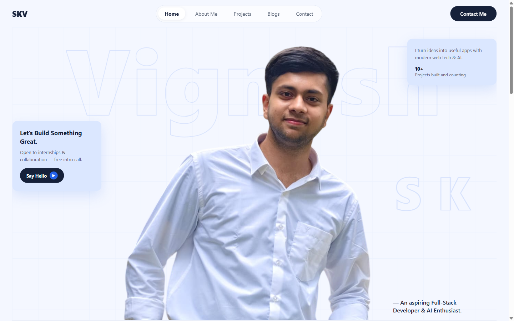
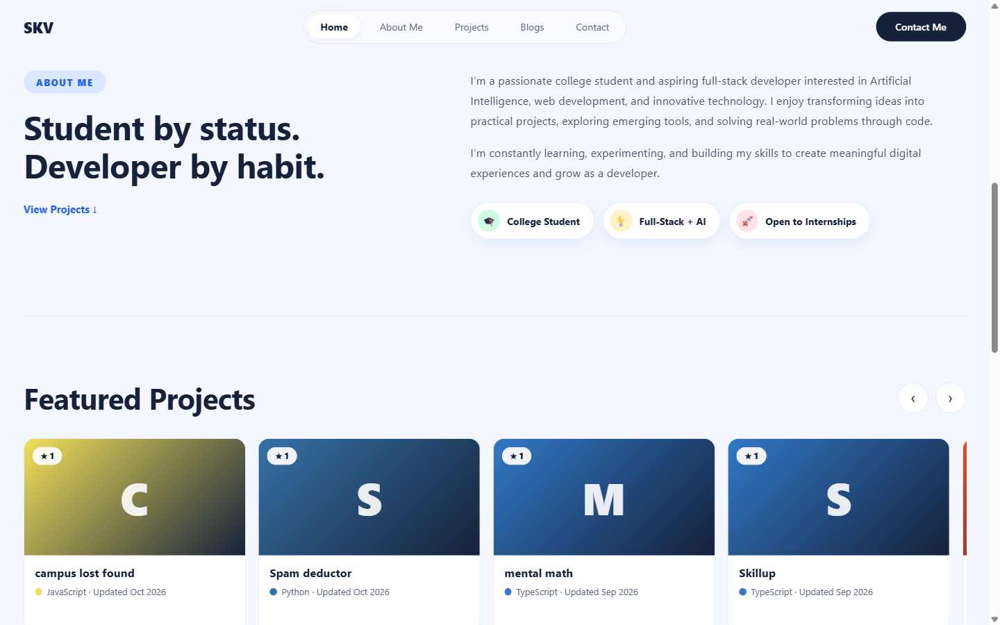
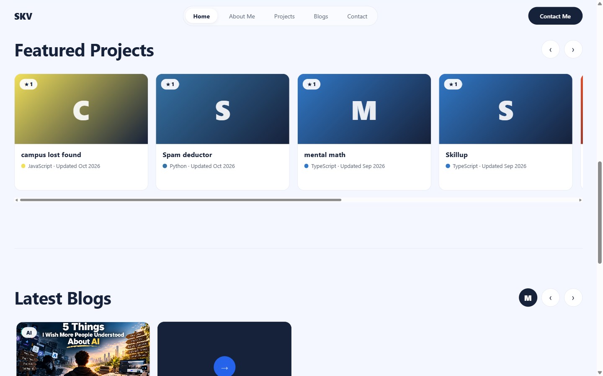
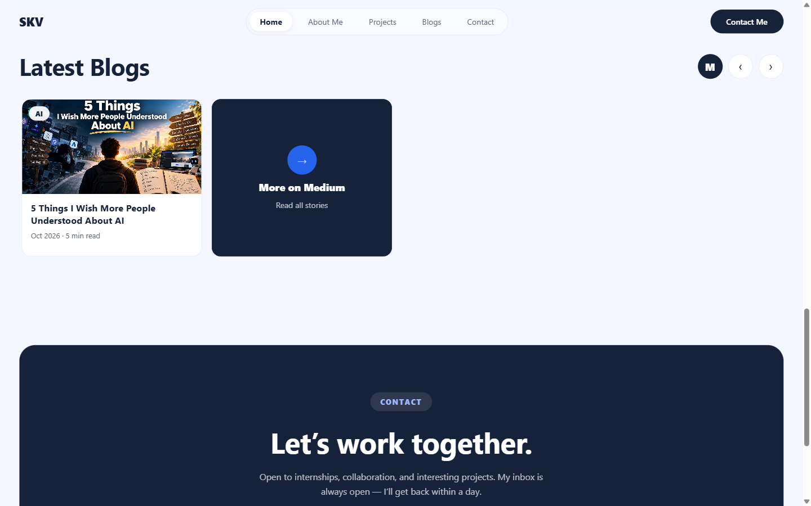
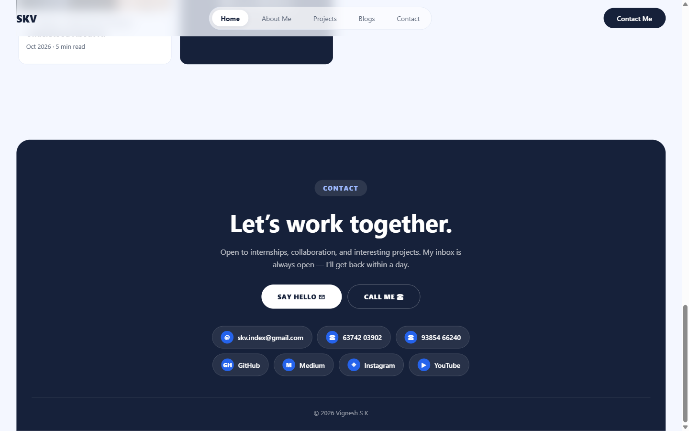

# Vignesh S K — Portfolio

Personal portfolio of **Vignesh S K**, aspiring Full-Stack Developer & AI Enthusiast.
Live at: `https://skv-index.github.io/portfolio/`

A single self-contained `index.html` (no framework, no build step) — open it in any browser, online or offline.

## Sections

### Hero
Full-screen intro with portrait cutout, giant outline typography, pitch cards, and a sticky frosted-glass navbar.



### About Me
Student-by-status, developer-by-habit — pitch, focus chips, and a shortcut to projects.



### Featured Projects
Sideways-sliding cards pulled **live from GitHub** (`skv-index`), with stars, language, and update date. Ends with a *More on GitHub* tile. Static fallback cards keep it working offline.



### Latest Blogs
Sideways-sliding cards pulled **live from Medium** (`@skv.index`), with cover art, category, and read time. Ends with a *More on Medium* tile.



### Contact
Dark footer band with email, tap-to-call phone numbers, and links to GitHub, Medium, Instagram, and YouTube.



## Run locally

```bash
git clone https://github.com/skv-index/portfolio.git
cd portfolio
python -m http.server 8080
# open http://localhost:8080
```

Or just double-click `index.html`.

## Contact

- Email: skv.index@gmail.com
- GitHub: https://github.com/skv-index
- Medium: https://medium.com/@skv.index
- Instagram: https://www.instagram.com/skv.index/
- YouTube: https://www.youtube.com/@SKV-index
